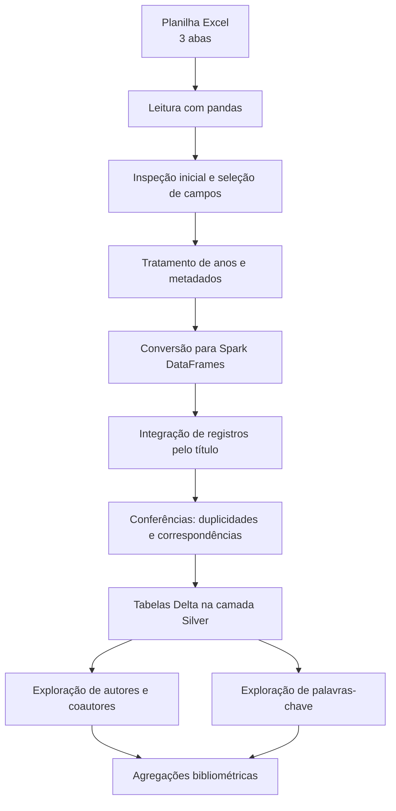

# Análise bibliométrica com Databricks

**Pipeline de tratamento e exploração de dados científicos com Python, PySpark, SQL e Delta Lake.**

Este repositório documenta a etapa computacional de uma análise bibliométrica sobre publicações relacionadas à **Teoria das Representações Sociais**, considerando o recorte de **2004 a 2024**. O projeto foi desenvolvido no contexto de uma pesquisa acadêmica e busca tornar rastreáveis os procedimentos usados para preparar e analisar os registros bibliográficos.

> **Escopo:** este repositório apresenta o processamento dos dados, e não a tese ou a interpretação acadêmica completa dos resultados. A base original foi organizada para uma pesquisa de terceiros; sua disponibilização depende de autorização e das condições de uso das fontes.

## Objetivo

Preparar e explorar um conjunto de registros de artigos científicos para apoiar a caracterização da produção bibliográfica, com atenção à consistência dos metadados e às possibilidades de análise por período, autoria, vinculação institucional e palavras-chave.

## Tecnologias

- **Databricks** — ambiente de execução dos notebooks;
- **Python e pandas** — leitura da planilha e tratamentos intermediários;
- **PySpark** — transformações, integração dos conjuntos de dados e agregações;
- **Spark SQL** — consultas e conferências de registros;
- **Delta Lake** — persistência de tabelas analíticas no ambiente Databricks;
- **Excel** — formato do arquivo de entrada utilizado no notebook.

## Dados de entrada

O notebook examinado utiliza uma planilha Excel com três abas:

| Aba | Uso no processamento |
| --- | --- |
| `Artigos` | Consulta a títulos, autoria, coautoria, ano, edição e links. |
| `Informações completas` | Base de registros com ano, autores, palavras-chave, área de estudo e outras informações bibliográficas. |
| `Geral` | Informações complementares, como tipo de artigo, região, instituição e tema/objeto de pesquisa. |

O arquivo é lido a partir de um caminho em **Databricks Volumes**. O caminho de origem precisa ser configurado conforme o workspace em que o notebook for executado. A presença de um arquivo com a mesma estrutura e cabeçalhos é necessária para reproduzir as operações.

## Fluxo de processamento



O diagrama resume os procedimentos identificados no notebook; não representa uma arquitetura de produção totalmente automatizada.

### 1. Leitura e inspeção

Leitura das abas da planilha com `pandas.read_excel`, visualização de amostras, inspeção das colunas e seleção de campos relevantes para a análise.

### 2. Tratamento do recorte temporal

Extração de anos a partir de campos textuais, incluindo tratamento de células mescladas na planilha de origem, e filtragem para excluir registros posteriores a 2024. O recorte da pesquisa é **2004–2024**; o notebook mostra explicitamente a filtragem pelo limite superior, mas a validação de todos os limites e critérios de inclusão depende da base e do restante do procedimento metodológico.

### 3. Integração de informações

Preparação das informações complementares da aba `Geral`, verificação de valores ausentes e títulos duplicados, e junção (`left join`) com os registros bibliográficos usando o campo `titulo`. O código também confere registros sem correspondência após a integração.

### 4. Autoria e coautoria

Separação de autor principal e coautores em registros individuais, contagem de ocorrências e autores distintos e padronização pontual de variantes de nomes. Essas operações permitem explorar a participação autoral no conjunto de artigos.

### 5. Palavras-chave

Separação das palavras-chave registradas em cada artigo, remoção de termos vazios, normalizações pontuais e contagem de artigos por termo. Padronizações específicas presentes no notebook não devem ser interpretadas como um vocabulário controlado exaustivo.

### 6. Persistência

Gravação de conjuntos tratados como tabelas Delta no catálogo `tese_bibliometria`, incluindo tabelas na camada `silver` relativas às informações bibliográficas, autorias e palavras-chave.

**Observação sobre as camadas:** embora o notebook faça referências a Bronze e Silver, parte das seleções e renomeações é aplicada já na preparação dos DataFrames de origem. Isso descreve a implementação observada; não implica que exista um pipeline Bronze–Silver–Gold completo neste repositório.

## Como executar

1. Tenha acesso a um workspace **Databricks** com suporte a Python, Spark e Delta Lake.
2. Disponibilize, de forma autorizada, o arquivo Excel com as três abas e os cabeçalhos esperados.
3. Ajuste a variável `file_path` do notebook para o caminho real do arquivo no workspace.
4. Verifique a existência do catálogo e do schema usados nas instruções `saveAsTable` e `spark.table`, bem como as permissões de leitura e gravação.
5. Abra ou importe o notebook no Databricks e execute as células na ordem, revisando previamente as dependências e os pontos destacados abaixo.
6. Confira as contagens, as correspondências entre bases e os resultados das agregações antes de reutilizá-los na pesquisa.

**Atenção:** o notebook original contém instruções de gravação em modo `overwrite`, que **substituem o conteúdo das tabelas de destino**. Evite executar essas células em um ambiente com dados que precisam ser preservados.

## Limitações e cuidados de reprodução

- O notebook consultado tem **75 células de código** e reflete uma sequência de desenvolvimento e exploração, com algumas reatribuições e verificações repetidas; não deve ser presumido um fluxo integralmente automatizado e validado de ponta a ponta.
- Algumas etapas de autoria e palavras-chave leem a tabela `tese_bibliometria.silver.artigos_bibliometria_tratada`, cuja criação **não aparece no notebook analisado**. É necessário confirmar onde ela é produzida antes de executar essas etapas.
- A integração pelo título requer conferência de duplicidades, diferenças de grafia e registros sem correspondência; uma junção por título não garante sozinha uma associação inequívoca.
- A divisão de coautores e palavras-chave depende dos delimitadores presentes nos campos originais; padrões diferentes exigem verificação manual.
- Não há, apenas com este notebook, comprovação de que todos os indicadores finais da tese ou todos os seus gráficos estejam implementados aqui.
- A execução integral e a equivalência dos resultados com a base original **não foram verificadas** neste repositório.

## Organização sugerida do repositório

```text
bibliometric-analysis-databricks/
├── README.md
├── notebooks/
│   └── informacoes_completas.ipynb
└── .gitignore
```

A estrutura acima é **sugerida**. O arquivo de notebook deve ser incluído no repositório com o nome e na pasta escolhidos no momento da publicação. Não é necessário publicar a planilha de origem caso sua divulgação não esteja autorizada.

## Responsabilidade e uso dos dados

A análise computacional foi produzida como serviço técnico de ciência de dados para apoiar uma pesquisa acadêmica. A disponibilização do código não transfere a autoria da pesquisa, nem autoriza a redistribuição de dados, documentos ou resultados inéditos de terceiros. Antes de publicar o notebook, revise saídas de células, caminhos, nomes e eventuais metadados que possam identificar materiais não autorizados.

## Licença

**Não definida.** A inclusão de uma licença de código aberto deve ser decidida após verificar a titularidade do código e eventuais condições contratuais relativas ao serviço prestado. Na ausência de licença, não se presume autorização geral para reutilização do código.

